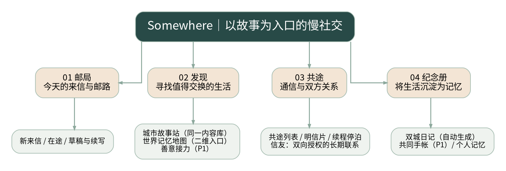
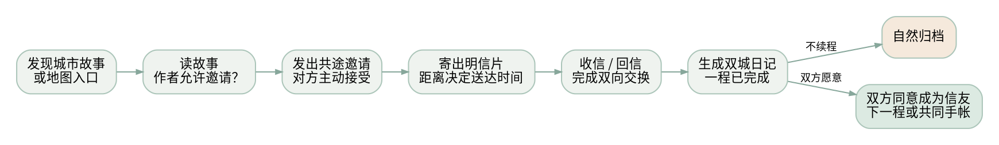
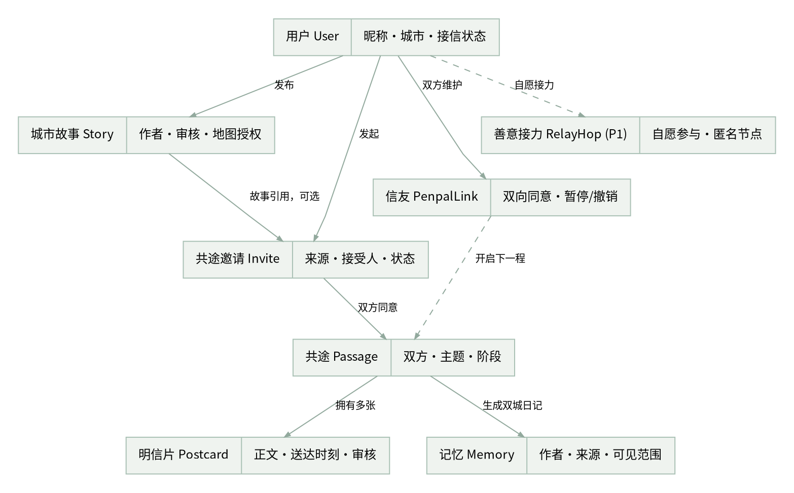

# SOMEWHERE

## 从城市故事到共途记忆

### 产品体系优化与 Web 本科毕业设计 PRD 2.1

**项目定位**：以城市故事发现、距离延迟明信片和有边界的「共途」为核心的慢社交 Web 系统  
**版本**：V2.1 · 2026-10-28 · 产品需求基线  
**平台**：响应式 Web（桌面优先，兼容移动浏览器）  
**建议技术路线**：Vue 3 + TypeScript + NestJS + PostgreSQL  
**产品主张**：世界很大，我们慢慢通信。每段关系都有自己的长度。

> 这份文档用于本科毕设的产品评审、界面设计、数据库设计、开发排期和验收。P0/P1/P2 是实现优先级，不代表所有内容必须在首次答辩演示中上线。各项用户体验指标是待验证假设，不是已证明的市场结论。

## 00. 执行摘要与 V1 → V2 变化

**核心机会**：现有笔友产品已经提供距离延迟送达、开放信件和好友匹配功能；Somewhere 不以「比别人更慢」竞争，而以「故事触发相遇—双方同意共途—共同记忆沉淀—关系可自然完成」作为核心闭环。[R1][R2][R3]

**一条完整的产品路径**：在「发现」中阅读城市故事／从地图发现故事 → 作者允许时发出共途邀请 → 双方同意后通过「邮局」寄递明信片 → 在「共途」中完成双向交换 → 自动生成「纪念册」的双城日记 → 自然归档或双方同意建立信友关系，并开启新一程。

| V1 设计 | V2 优化 | 原因与收益 |
|---|---|---|
| 发现页以主题匹配为主 | 城市故事站 + 世界记忆地图 + 善意接力 | 用真实内容与城市作为相遇理由，保留弱关系路径 |
| 共途近似全部关系的入口 | 信友（人际联系）与共途（经历单元）分离 | 既允许长期信友，也不强迫每次相遇成为好友 |
| 纪念册以双城日记为主 | 双城日记 / 共同手帐 / 个人记忆三层 | 解决记录重叠、编辑权和隐私边界 |
| 地图是可选装饰 | 地图与城市故事共用内容与授权 | 支持发现但不重复开发内容审核和存储 |
| 功能上线范围偏宽 | P0 核心闭环，P1 接力和手帐，P2 媒体增强 | 符合本科独立开发的资源与风险约束 |

**北极星目标**：在不制造频繁回复压力的前提下，让真实用户完成一次有意义的双向明信片交换，并愿意自主开启下一程或保存这段记忆。

## 01. 产品定位、原则、用户

### 1.1 定位与非目标

Somewhere 是为愿意慢慢表达的成年用户设计的 Web 慢社交产品。它既不是即时聊天替代品，也不是无限内容消费平台。它让不同城市的日常片段成为相遇的入口，用有送达时间的信件承载交往，并让关系完成后的记忆有独立价值。

**原则**：故事先于资料；双方同意先于持续联系；完成不等于失败；记忆不以持续回复解锁；公共内容默认最少暴露个人信息；等待可以被感知但不被催促；演示数据与真实用户数据必须标记区分。

**不做**：关注量排行、颜值匹配、在线状态、已读催促、付费加速、连续签到奖励、公开好友关系排行榜、可追踪用户精确地理位置的路线图。

### 1.2 用户与角色

- **第一次来访者**：看到一段异地生活，想低压力地寄出第一张卡片；需要明确「发出邀请并不意味着已经送达」。
- **轻度分享者**：偶尔记录一次城市日常；不愿为了发布内容而运营个人主页。
- **长期信友**：愿意和少数人持续通信，并保存重要的共同回忆；需要主动可控的联系方式和共同编辑权限。
- **志愿测试者与管理员**：帮助小规模封闭测试中的内容审核、举报处理与系统演示；需要独立审核后台和操作审计。

**后台账号角色（规划，分阶段实现）**：

| 角色 | 标识 | 职责 |
|---|---|---|
| 普通用户 | `USER` | 使用 Somewhere 的慢社交功能 |
| 内容审核员 | `MODERATOR` | 审核公开内容、处理举报 |
| 城市故事策展人 | `CURATOR` | 管理精选城市故事和专题 |
| 系统管理员 | `ADMIN` | 用户管理、角色授权、平台维护 |

`GUEST` 只表示未登录游客，不写入用户数据库，不作为正式账号角色。`ADMIN` 不允许查看其他用户的邮箱，也不代表可以无条件读取用户的私人信件、共同日记和个人记忆。当前代码仍只实现 `USER | ADMIN` 与 `ADMIN` 故事审核；四角色模型、角色管理和策展能力属于规划，详见 `specs/15-roles-and-permissions.md`。

MVP 先运行于受控演示环境；成年人身份自我声明不等于可靠年龄核验。若后续面向公众运营，应进一步评估身份核验和安全运营要求。

## 02. 四大导航与功能边界

| 顶级导航 | 核心问题 | 一级页面 | 归属边界 |
|---|---|---|---|
| 邮局 | 有什么信需要我处理？ | 新来信／在途／草稿与续写 | 以「信件」为中心，负责投递与收取 |
| 发现 | 我想从哪段生活开始？ | 城市故事站／世界记忆地图／善意接力 | 以「公共发现」为中心，不负责私密往来 |
| 共途 | 我和谁正在经历什么？ | 正在进行／已完成／写明信片／续程停泊／信友 | 以「有边界的经历与通信许可」为中心 |
| 纪念册 | 我们留下了什么？ | 双城日记／共同手帐／个人记忆 | 以「内容所有权、回顾、收藏」为中心 |

**Web 导航适配**：桌面屏幕（≥1024px）保留相同四个顶级入口但用左侧固定导航栏；平板可折叠为窄侧栏；移动浏览器（<768px）使用四项底部导航。信息架构保持四项不变，并不要求 PC 界面机械地放一个底部 Tab Bar。

**跨导航的统一对象**：故事（Story）→ 邀请（Invitation）→ 共途（Passage）→ 明信片（Postcard）→ 记忆（Memory）。导航只是观察对象的不同角度，不复制对象与权限。

### 2.1 内容与关系的三个维度

- **发现层**：公开故事与地图共享同一内容 ID；是否公开、是否上地图、是否允许私信邀请分别授权。
- **关系层**：共途是一次可完成的主题经历；信友是双方同意且可撤销的长期联系许可；善意接力属于弱连接路径，不生成信友。
- **记忆层**：双城日记属于完成的共途；共同手帐属于双方长期协作空间；个人记忆属于用户自己的私密容器。任何公开展示都需另行同意。

## 03. 四大模块的详细体验

### 3.1 邮局：让等待被看见，但不催促

**信息分区**：① 新来信（已送达可打开）；② 在途（寄出／收取，正文不可预览）；③ 继续写信（草稿及有权回复的共途）。已收到信件可在「共途」查看上下文，在邮局打开时不额外复制存储。

**主要卡片字段**：寄件者昵称或匿名标签、来源城市（若其选择公开）、邮票插画、当前状态、预计送达时刻、关联共途主题。默认不显示已读回执或在线状态。

**边界**：邀请等待匹配时不列入「在途信件」；邮递开始后的交付时间由服务端写入；截止时刻到达后仍需通过权限／审核判断正文是否可读。退信、隔离与异常要有用户可理解的状态，不制造虚假邮递轨迹。

### 3.2 发现 A：城市故事站（P0）

**定义**：一座容量有限、人工审核后展示的城市生活故事池，不是无限滚动的公开动态流。作者以主题和城市分享短片段（例如「雨夜书店」「清晨地铁」「一次温柔的偶遇」），其他用户可阅读与保存，但并不天然取得联系作者的权利。

**推荐产品规则（可配置）**：每个用户最多保有 2 则正在展示的故事；故事首次展示窗口建议 30 天，到期归档且不再进入公共轮播；发现首页每天最多轮播 24 张经审核卡片，不以浏览量排序；新故事必须先审核再展示。容量约束用于节制曝光，并非删除作者的私人副本。

**发布表单**：标题（≤40 字）、正文（建议 80–400 字）、城市 ID（用户主动选择）、主题标签（最多 3 个）、显示城市开关、上地图开关、是否接受陌生共途邀请开关（默认关闭）。所有开关独立，取消授权后公共入口立即失效。

**流转**：草稿 → 待审核 → 通过/退回 → 展示中 → 到期/撤回。待审核和驳回的故事不可被其他普通用户查询到正文。

**从故事到共途**：如果作者允许邀请，读者看到「寄出一张共途邀请」。进入写卡片页后由对方自主接受；未同意不能直接写入私人收件箱。每人每日邀请限额建议 2 次，并禁止反复向同一作者发送未获回应邀请。

**空状态**：故事池不足时展示官方明确标记的示例内容／主题提示和「写自己的第一段故事」，绝不伪造真实用户；地图标记只来自真实审核通过且授权展示的内容。

### 3.3 发现 B：善意的接力（P1）

**体验**：用户写一封给陌生人的鼓励，系统从明确选择参与接力且容量充足的人中找收信者；收信者可以自行结束，也可以在以后主动写一封新的鼓励给第三个人。上一封原文不自动转寄，也不向下一人暴露前一人的身份。

**接力不是欠债链**：没有强制时限、连续传递排名或「请不要中断」的情感负担。起点用户看到的是经授权、仅有匿名站点数量的故事（例如「善意已到达下一站」），而不是可追踪个人的真实路径。未匹配时显示等待，不伪造站点。

**P1 约束**：单条接力建议最多 5 个自愿节点；每个账户同一链条只可参与一次；每次继续都是一条新的独立信件；未通过审核的内容不进入匹配；用户封锁、退订或链条到期应中止后续匹配。

**为何不列 P0**：陌生匹配、匿名性、滥用审核、消息流向权限及冷启动问题叠加，做成可靠系统的复杂度显著高于静态演示。毕设可先完成流程原型和状态机单测，再作为 P1 开发。

### 3.4 发现 C：世界记忆地图（P0）

**定位**：地图不是第二个内容平台；它是城市故事站的另一种发现视图。每个城市点展示「经审核且授权上图」的故事数量与精选卡片，点击后进入同一 Story ID 的详情页。

**位置规则**：城市级预置地理数据，不收集 GPS 或住址；地图标记采用城市中心点或预设模糊坐标，禁止精确个人定位；对于样本极少、可能重新识别个人的地区，可隐藏计数、合并至更大地区或不显示。

### 3.5 共途：把「一段经历」从「一个联系人」中分离（P0）

**共途 Passage**：一次双方愿意参与、具有主题和完成条件的通信。MVP 完成条件统一为「双方各寄一张已成功送达的明信片」；完成后可以归档，或发起新一程，旧内容不重复编辑。

**信友 PenpalLink**：双方完成至少一次共途之后，可发出「成为信友」邀请；必须分别同意，才建立可撤销的联系许可。信友不是自动生效的永久私信资格：开启新的共途或发送私人邀请仍受接信意愿、频率、停泊和封锁规则约束。**信友可以有多段共途，一段共途也可以结束而不成为信友。**

**停泊与结束**：任一方可暂停接信或结束当前共途；停泊到期只允许本人重新选择是否恢复；结束后不得借旧链接继续发送新信。归档只影响通信与编辑权，不自动擦除所有双方已合法保存的内容。

### 3.6 纪念册：三个不同的内容容器

| 容器 | 生成与管理 | 谁能编辑 | 适用关系 | MVP 版本 |
|---|---|---|---|---|
| 双城日记 | 一次共途完成后自动生成两封信的只读双页 | 不直接改写原信；作者按保留政策处理自己的内容 | 一次相遇、短期共途 | P0 |
| 共同手帐 | 双方主动创建同一主题的共享时间轴 | 双方对自己贡献的条目编辑；需留历史版本 | 已互认信友／长期共途 | P1：文字与里程碑 |
| 个人记忆 | 用户私人收藏、写感想和标注日期 | 本人 | 所有关系、也可独立记录自己 | P0：私人笔记 |

**共同手帐的惊喜设计（P2）**：在对方允许的情况下添加图片、音乐链接或小插画。首版不上传音频文件，不自动播放第三方受版权保护的音乐；链接要进行安全校验，媒体展示和转存应获得单独授权。

**强制边界**：纪念册不生成公开动态；双城日记不因为一方注销而默认为永久公开；个人记忆不能因为与对方曾经有关系就开放给对方。

## 04. 四条核心用户旅程

### F01. 城市故事 → 共途 → 双城日记（P0 主流程）

1. 用户在发现页看到一段经审核的城市故事；点击故事进入详情，看到作者是否愿意接收邀请。
2. 如允许邀请，读者选择「交换一个雨天」主题并写下第一张明信片；系统创建邀请，状态为「等待对方接受」，此时信件并未进入邮路。
3. 作者接受后，系统使用事务锁定邀请，创建唯一共途并计算邮递时间；双方收到共途启动反馈。
4. 第一封信在到达 `deliver_at` 后，且收信者通过权限校验，才可读正文。对方可自愿回信。
5. 两封信分别完成真实投递，系统生成一页只读双城日记；共途标为「已完成」。
6. 双方各自选择自然归档或邀请下一程；建立信友关系需要另外的双向确认。

**验收重点**：邀请不能被多人同时接受；未送达正文不能泄露；已完成不能重复生成记忆；故事撤回后地图和故事站同步取消公共可见性。

### F02. 无人回应 → 自然结束（P0）

已寄出不等于获得回信。系统不设计「对方欠你一封信」的惩罚性提醒。用户可以在信件投递结束后主动结束共途，保留有权查看的原信和个人记录；对方不因此收到羞辱性提醒或亲密度惩罚。

### F03. 已完成共途 → 双向信友 → 下一程（P0）

完成双向交换后，A 发出信友邀请；B 可以同意、忽略或拒绝；仅双方同意时生成 PenpalLink。任何一方撤销、停泊或封锁后，新的直达邀请停止。历史共途独立存在；下一程是新的 Passage ID，不改变已完成共途的内容版本。

### F04. 善意接力（P1）

用户自愿参与 → 写鼓励卡并审核 → 同意接收的下一位参与者被匹配 → 信件按距离送达 → 接收者可以结束，也可另写新卡片接力 → 仅公布授权的匿名链条里程。任何一步退出都不构成失败，也不能让前一位直接找到后一位。

## 05. 关键页面规格与响应式规范

**PC 主框架（约 1440px）**：左侧 220–240px 四入口固定导航；中间 720–840px 内容区；右侧 240–280px 可选情境栏（在途邮路、我的接信意愿、帮助提示）。阅读内容宽度建议不超过 760px，避免长篇信件难读。

**平板 / 手机**：平板收起右侧栏并折叠左导航；手机底部四导航，右侧信息折叠为卡片，地图支持列表视图回退。手机和桌面共享同一套 URL 及业务语义。

| 页面 / 路由 | 主体内容 | 关键 CTA | 空状态或异常 |
|---|---|---|---|
| `/post-office` | 新来信、在途、草稿 | 打开信／继续写 | 无信时展示写信入口与真实状态 |
| `/discover/stories` | 轮播故事、主题与城市筛选 | 阅读故事／发布故事 | 审核池空时显示清楚标记的引导 |
| `/discover/stories/:id` | 故事正文、城市与作者授权信息 | 发出共途邀请 | 不可见时显示撤回或未开放 |
| `/discover/map` | 城市故事发现、城市筛选、故事列表 | 阅读城市故事 | 无授权数据时显示空城市而非伪造点 |
| `/discover/relay` | 接力规则、参与／退出（P1） | 自愿参与 | 不给用户呈现必须接力的压力 |
| `/passages` | 进行中／已完成／已停泊 | 查看共途 | 没有共途时导向故事站 |
| `/passages/:id` | 成员、主题、信件、状态 | 回信／归档／续程 | 无权访问返回通用不可用状态 |
| `/compose` | 明信片模板、正文、预览 | 保存草稿／寄出 | 未匹配不能伪显示在途 |
| `/postcards/:id` | 邮递状态或已送达正文 | 查看／回信 | 未送达仅显示状态，无正文元数据泄露 |
| `/penpals` | 已互相同意的信友 | 发起新共途／暂停 | 单方请求不显示为已是信友 |
| `/albums/diaries` | 已完成共途双页 | 阅读／收藏 | 未完成不伪生成双城日记 |
| `/albums/personal` | 私人笔记与保存 | 写个人记忆 | 永远不默认为公开 |
| `/albums/notebooks` | 共同手帐时间轴（P1） | 添加事件 | 无信友共识不可编辑 |
| `/settings/privacy` | 接信意愿、地区展示、屏蔽 | 更新授权 | 默认隐私优先且可撤销 |
| `/admin/moderation` | 审核、举报、封禁记录 | 审核／处理 | 普通用户不可进入 |

**视觉关键词**：纸张暖白、鼠尾草绿、暖陶土、深墨绿；把图案和留白作为气质元素，但所有内容操作依旧要有清晰的可点击反馈。遵循键盘导航、可见焦点、图片替代文本及避免只用颜色区别状态。

## 06. 需求清单与验收口径

所有 P0 功能必须具备前端入口、后端权限、数据存储与异常提示；只有界面而无业务实现不算验收。优先级规则：P0 = MVP 必须；P1 = 稳定后迭代；P2 = 后续体验增强。

| 编号 | 需求 | 优先级 | 可验证的验收条件 |
|---|---|---|---|
| AUTH-01 | 注册、登录、退出 | P0 | 未登录请求私密 API 被拒绝；退出会话立即失效 |
| AUTH-02 | 城市、语言、接信意愿 | P0 | 默认不采集精确 GPS；修改接信意愿即时影响匹配 |
| OFF-01 | 邮局的新来信、在途、草稿 | P0 | 三类状态独立；在途无正文；草稿可继续编辑 |
| OFF-02 | 明信片编辑与预览 | P0 | 文字长度校验；草稿与发送版本分离；发送不可无意重复 |
| OFF-03 | 距离延迟投递 | P0 | 送达前收件人无法从任何 API 读取正文 |
| OFF-04 | 投递异常及审核隔离 | P0 | 被隔离或封锁的内容即使时间已到也不可阅读 |
| DIS-01 | 故事草稿与发布申请 | P0 | 只对作者显示待审核内容，公开端不可查询 |
| DIS-02 | 有限审核故事池 | P0 | 仅 APPROVED 且有效的故事展示，额度限制生效 |
| DIS-03 | 故事来源的共途邀请 | P0 | 只有作者允许接收共途请求时，读者才可发起联系 |
| DIS-04 | 世界记忆地图 | P0 | 地图仅显示已授权且已审核的故事，详情 ID 与故事站一致 |
| DIS-05 | 善意接力基础链路 | P1 | 仅在双方自愿情况下匹配，不自动转寄原文 |
| DIS-06 | 接力节点匿名化与终止 | P1 | 退出或封锁后不可再匹配，不可获取接力者身份链 |
| PAS-01 | 共途邀请和接受 | P0 | 共途启动需要双方同意，参与者可忽略或拒绝邀请 |
| PAS-02 | 共途详情与单次双向交换 | P0 | 仅双方可查看共途私密内容；两封均已送达才完成 |
| PAS-03 | 共途归档、暂停、结束 | P0 | 任一方可退出；权限实时生效；历史内容遵守保留规则 |
| PAS-04 | 共途续程 | P0 | 创建新 Passage ID，旧共途内容不被改写 |
| PAS-05 | 双向信友关系 | P0 | 一方请求不算信友；双方接受后可独立暂停与撤销 |
| PAS-06 | 信友发起新共途 | P0 | 仍需满足接信、频率、屏蔽与双方同意规则 |
| MEM-01 | 自动双城日记 | P0 | 一次完整双向交换（两封均已送达）生成一份只读双页，不重复生成；共途进度状态不参与判定 |
| MEM-02 | 个人记忆 | P0 | 仅本人可编辑、查询；不可被共同手帐接口读取 |
| MEM-03 | 共同手帐（文本里程碑） | P1 | 需双方授权；添加记录关联作者与历史版本 |
| MEM-04 | 手帐图片、画作、音乐链接 | P2 | 明确上传授权、大小与媒体安全规则，再开放 |
| SEC-01 | 内容举报与封锁 | P0 | 被封锁用户不能通过故事、共途或信友权限绕过限制 |
| SEC-02 | 故事审核后台 | P0 | 管理员操作有审计；普通用户无法访问后台 |
| SEC-03 | 数据删除与撤销公开授权 | P0 | 撤回后故事与地图同时下线；私人数据遵照约定保留政策 |
| SEC-04 | 请求限额与反垃圾内容 | P0 | 单日邀请与故事数量限额在后端执行 |
| UX-01 | PC/手机响应式四入口 | P0 | 1280px PC 和 390px 手机浏览器均可完成主流程 |
| UX-02 | 所有关键状态的空页与错误文案 | P0 | 至少覆盖无人匹配、未送达、审核中、暂停、无权访问 |
| ANL-01 | 关键事件埋点 | P0 | 可统计故事查看、邀请、送达、双向完成、归档和投诉 |
| OPS-01 | 可复现的演示环境 | P0 | 导入受控演示数据，演示账号不得假扮真实用户 |

## 07. 领域模型、数据结构与状态机

### 7.1 核心实体与数据约束

| 数据表 | 关键字段 | 约束或说明 |
|---|---|---|
| `users` | id, nickname, email, status, city_id, language | 邮箱不公开；账号状态和接信权限独立 |
| `cities` | id, name, country, lat, lon, granularity | 预置城市中心点，支持降级为地区级 |
| `stories` | id, author_id, city_id, title, body, review_status, visibility, map_opt_in, invite_opt_in, expires_at | 故事站与地图查询同一主键，不生成第二份正文 |
| `invitations` | id, initiator_id, story_id?, receiver_id?, state, expires_at | 事务中只允许一次成功接受；限制重复请求 |
| `passages` | id, theme_id, member_a, member_b, state, completed_at | 同一邀请生成一个共途；成员归一化存储 |
| `passage_members` | passage_id, user_id, paused_until, can_receive, ended_at | 双方独立设置；权限不由单个全局 state 推断 |
| `postcards` | id, passage_id, sender_id, receiver_id, body, sent_at, deliver_at, moderation_state | 送达前正文不向收件人返回 |
| `penpal_links` | id, member_a, member_b, a_consented, b_consented, revoked_at | 同一无序用户对唯一；可撤销、可暂停 |
| `memories` | id, owner_id, source_passage_id?, type, visibility, payload | DIARY / PERSONAL；按字段和来源授权 |
| `shared_notebooks` | id, penpal_link_id, title, status | P1；长期共有但各方权限分离 |
| `notebook_items` | id, notebook_id, author_id, milestone_at, body, version | P1；作者与版本不可丢失 |
| `relay_chains / relay_hops` | chain_id, hop_index, sender_id, receiver_id, status | P1；对外仅暴露允许公开的匿名摘要 |
| `reports / blocks / audit_events` | reporter_id, target_id, reason, state, occurred_at | 审核可追踪；封锁优先级高于好友和共途 |

**数据库强约束**：用户、信件、共途及信友关系应使用外键、唯一约束和事务保证一致性。完成共途与生成双城日记必须具备幂等性。故事站和世界记忆地图引用同一故事与授权结果，不得形成无法同步撤销的独立公开副本。

### 7.2 独立而不是混淆的状态

- **故事**：DRAFT → PENDING → APPROVED / REJECTED → EXPIRED / WITHDRAWN。公开展示还受 `visibility`、`map_opt_in` 和审核结果共同限制。
- **共途**：INVITED → ACTIVE → COMPLETED → ARCHIVED；任何时刻允许安全终止为 ENDED。暂停是用户级的投递权限，不是假装共途「倒退」到过去状态。
- **信件**：DRAFT → SENT（在途）→ DELIVERED；审核可导致 QUARANTINED / REJECTED，封锁可覆盖读取权限。
- **信友**：PENDING_CONSENT → ACTIVE（双方同意）→ PAUSED / REVOKED。旧共途是否已完成，不代表信友关系自动有效。
- **善意接力**：OPTED_IN → MATCHING → IN_TRANSIT → RECEIVED → CLOSED / OPTED_OUT。收信人只有自己开始新的消息时才有下一跳。

### 7.3 优先级最高的授权判定

读取某张**收件**明信片的正文必须同时满足：`用户是该收件人`；`服务器时间 >= deliver_at`；`审核可阅读`；`没有生效的封锁或安全拦截`；`该用户拥有该信件的合法访问权限`。寄件人在规定范围内查看自己已发送正文可按独立权限处理。前端状态、请求中的时间参数、推送是否收到，都不能决定服务端是否返回正文。

**互斥行为**：单方发出信友邀请 ≠ 已成为信友；作品归档 ≠ 对方同意继续；可读城市故事 ≠ 可联系作者；浏览地图 ≠ 可以获得作者的精确位置；完成共途 ≠ 永久允许私信。

## 08. 关键算法与接口草案

### 8.1 地理距离和送达时间

两座城市中心点使用 Haversine 计算球面最短距离 `D (km)`。沿用既有体验参数：`T_hours = min(120, 12 + D / 150)`；同城近似 12 小时，距离越长送达越慢，最多 120 小时。该规则属于**产品模拟邮递时间**，不得宣传为真实国际邮政时效。

计算在服务端首次正式发信时执行，保存不可由客户端修改的 `sent_at` 和 `deliver_at`。页面仅通过 API 获取状态与估计时间。演示模式应通过专用测试数据或管理员工具展示，绝不对真实用户暗中改变交付承诺。

### 8.2 REST API 草案（以资源为中心）

| 方法 / 路由 | 功能 | 核心权限 |
|---|---|---|
| `POST /auth/login` | 登录 | 限流与会话保护 |
| `GET /post-office` | 邮局摘要 | 登录本人 |
| `GET /stories` | 审核故事列表 | 仅公开有效记录 |
| `POST /stories` | 新建故事草稿 | 登录本人、额度限制 |
| `POST /stories/{id}/submit` | 申请审核 | 作者本人 |
| `POST /stories/{id}/withdraw` | 取消公开展示 | 作者本人 |
| `POST /invitations` | 创建共途邀请 | 作者邀请授权、反骚扰限流 |
| `POST /invitations/{id}/accept` | 接受邀请 | 指定接收者，事务防并发 |
| `GET /passages/{id}` | 共途详情 | 双方成员或有权限管理员 |
| `POST /passages/{id}/postcards` | 发送卡片 | 可发送状态、内容审核、幂等 |
| `GET /postcards/{id}` | 卡片详情 | 送达时刻及封锁审核校验 |
| `POST /passages/{id}/complete` | 完成检查 | 服务端判断双向送达，不相信前端标记 |
| `POST /passages/{id}/archive` | 自行归档 | 成员本人；不能改写对方副本 |
| `POST /penpal-links` | 申请信友 | 完成共途及接信意愿校验 |
| `POST /penpal-links/{id}/consent` | 信友同意 | 对方本人 |
| `POST /penpal-links/{id}/revoke` | 撤回联系 | 任一成员 |
| `GET /albums/diaries` | 双城日记 | 各自授权的双页 |
| `POST /albums/personal` | 私人回忆 | 仅本人 |
| `POST /reports` | 举报 | 登录本人，不向被举报者披露举报人 |
| `POST /admin/stories/{id}/review` | 审核故事 | 仅管理员，操作留日志 |

可在 NestJS 使用 DTO 校验与守卫做认证，具体对象级权限校验必须置于服务层，并按照「默认拒绝、每次请求都验证」原则实施。[R4]

### 8.3 技术选型

**P0 推荐**：Vue 3 + TypeScript + Vite + Pinia + Vue Router；Tailwind CSS + 自定义卡片组件；NestJS + PostgreSQL + TypeORM；Swagger/OpenAPI；Docker Compose + Nginx；Vitest/Jest/Playwright。开发与演示环境可复用成熟邮件服务和数据库备份方案。

**暂不引入**：实时 WebSocket 聊天服务、Redis 复杂队列、Kubernetes、微服务、大模型自动代写和自动审核替代人工。首次提交的小规模场景可用数据库时间筛选来保证读取权限，后续再按投递量追加可靠通知队列。

## 09. 内容安全与隐私风险控制

### 9.1 城市故事与位置隐私

公共故事展示与世界记忆地图展示应分别征得用户同意；用户可以随时撤销公开授权。公共内容不应暴露家庭、学校或精确个人位置，低样本地区需避免将生活片段与个人身份关联。故事审核需覆盖个人身份泄露、骚扰及其他不适宜公开内容。

### 9.2 信友、共途与善意接力

封锁覆盖所有路径：故事邀请、共途、信友和接力匹配；暂停状态不应被利用来反复通知对方；同一双方未接受邀请的重复发送应限流。接力不提供可反向追查用户身份的路径，最多呈现经同意的匿名站点摘要。

### 9.3 共同手帐与媒体

个人笔记默认仅本人可见；共享条目按作者和共同空间分别授权；涉及作品导出或公开时另行征得同意。P2 图片与歌曲支持之前，需完成上传安全、元数据清理、版权及外部链接隐私评估。严禁将受版权保护歌曲直接作为 App 内置音乐资源使用。

### 9.4 本科毕设的现实运营边界

本科毕设建议先在可控的教学演示环境中运行，使用清楚标注的演示账号与预置内容。若开放给真实用户，必须准备内容审核、举报响应和账户退出机制；成年人自我声明不能替代可靠的年龄核验。

## 10. 版本路线与开发排期

| 周次 | 交付内容 | 验证门槛 |
|---|---|---|
| 1–2 | 需求基线、Figma 线框、页面与状态定义 | 5 位测试者可理解四入口、共途与信友区别 |
| 3–4 | 用户登录、城市数据、数据库迁移、基础框架 | 自动化认证与对象级权限测试通过 |
| 5–6 | 邮局、明信片编辑、地理延迟投递 | 时间边界、重复发送、断网恢复测试通过 |
| 7–8 | 城市故事站、审核后台、故事邀请 | 未审批内容不公开；双方同意后才能开始共途 |
| 9 | 世界记忆地图 | 用户能从城市进入授权故事，撤回后不再公开 |
| 10–11 | 共途完成、信友同意、双城日记、私人记忆 | 归档与联系权限相互独立，不能越权 |
| 12 | UI 细化、PC/移动响应式、错误与空状态 | 完成主要用户任务的可用性走查 |
| 13 | 测试、Bug 修复、备份和部署 | 自动化与人工验收用例通过 |
| 14 | 论文材料、演示脚本、应急演示数据 | 在断网/失败预案下仍可清楚展示关键逻辑 |

P1（完成毕设 P0 之后）：真实善意接力（匹配、匿名链、限额、退出）、共同手帐（文字里程碑、版本）和精选卡片模板。P2：图片与音乐媒体、长周期时间胶囊、跨语言翻译及实体明信片印制。

**压缩预案**：若单人时间不足，优先保留「邮局—城市故事—共途—双城日记」完整闭环，地图保留城市故事发现与跳转需求，信友采用双向授权基础版；不可牺牲投递与安全边界。

## 11. 留存机制、研究假设与指标

**短期循环（数日）**：故事触发好奇 → 愿意发邀请 → 明信片按距离抵达 → 收到一个真实回应。  
**中期循环（数周）**：共途完成 → 双城日记生成 → 双方自愿续程或成为信友。  
**长期循环（数月）**：翻阅私人记忆／共同手帐 → 看到某段生活变化 → 自愿再寄一张明信片。

| 指标 | 定义与意义 | 注意事项 |
|---|---|---|
| 故事 → 共途转化 | 阅读城市故事后自主开启共途的用户比例 | 仅观察用户自愿开启的共途，不代表关系质量 |
| 双向共途完成率 | 已启动共途中双方各有一张已送达卡片的比例 | 需排除尚未过送达窗口的样本 |
| 首次记忆收藏率 | 完成共途后，主动阅读或收藏双城日记的比例 | 不能自动计为有意义行为 |
| 28/90 天主动复访 | 用户再次阅读记忆、写信或发起新共途的比例（分项报告） | 慢社交不宜只盯每日活跃 |
| 社交压力与投诉 | 问卷中「感到欠回复」比例、封锁、举报、审核压力 | 若压力升高，不能因发信量增加而判断成功 |

所有转化率目标均为毕设实验假设；30–60 名种子用户不足以证明长期留存或产品市场契合度。若需要比较机制，建议使用不误导参与者的小规模可用性任务与访谈，不把模拟账户产出的数据当作真实用户留存。

## 12. 可执行验证、验收与本轮检查结果

### 12.1 已运行的概念级自动化检查

此前独立的 Python 规则模型完成了 **19 项概念级用例检查**，其中包含 **100,000 组随机距离**的时间单调性与边界检查。本版重点保留与需求直接相关的验证结论：距离规则、未审核故事不可公开、公开内容撤回、信件未送达前不可读取、封锁优先于通信许可、个人与共享记忆的访问边界。

**边界声明**：上述结果只验证设计规则模型，并不代表 NestJS、PostgreSQL 或 Web 应用已通过集成测试。正式系统仍需验证送达时间、内容权限和重要用户流程。

### 12.2 产品与开发阶段的验收测试

| ID | 用户场景 | 通过条件 |
|---|---|---|
| AT-01 | 新用户第一次寻找故事 | 能在 3 次主要点击内打开一则城市故事 |
| AT-02 | 提前修改浏览器时间 | 收件人仍无法在 `deliver_at` 之前读取正文 |
| AT-03 | 公共故事被撤回 | 城市站、地图、搜索均同步不可见 |
| AT-04 | 参与者不愿续程 | 可自然归档，无负面惩罚或骚扰提醒 |
| AT-05 | 一方申请成为信友 | 另一方未同意前，联系关系不生效 |
| AT-06 | 一方停泊或撤销 | 所有新投递入口即时关闭，已发信按规则处理 |
| AT-07 | 非共途成员访问卡片链接 | 服务端拒绝返回正文或个人资料 |
| AT-08 | 双城日记生成 | 同一共途只生成一份对应记录，分别按权限展示 |
| AT-09 | 用户访问个人记忆 | 另一账号即使猜中 ID 也不能读取或修改 |
| AT-10 | 善意接力参与者退出（P1） | 不再匹配新节点；此前站点信息不泄露个人身份 |
| AT-11 | 审核员驳回公共故事 | 公共端始终不可看到正文，后台保留审计 |
| AT-12 | PC/手机主要路径 | 1440px 和 390px 页面均可完成寄信、收信、归档 |

### 12.3 需求冲突与重叠检查结论

- **发现故事站 vs 地图**：共享 `stories` 数据，地图只作为授权筛选视图；避免两个独立审核池。
- **故事邀请 vs 直接信友**：故事仅提供一次有边界邀请；信友需要完成共途和双向同意。
- **善意接力 vs 共途**：接力不需要回复，不触发笔友关系，数据可关联信件但不要复用双人完成规则。
- **双城日记 vs 共同手帐**：前者来自一次完成的共途，默认只读；后者是持续可编辑空间且独立授予权限。
- **个人记忆 vs 其他收藏**：个人记忆是私密实体，不是默认公开的二次转发。

## 13. 风险事前推演（Pre-mortem）

| 失败情形 | 最可能原因 | 初步预防或降级 |
|---|---|---|
| 发现页只有很少真实故事 | 冷启动内容供给与审核成本 | 有限种子作者、明确标注的编辑示例、有限轮播 |
| 用户只看故事但不写信 | 写信成本高、拒绝风险 | 三行式卡片、清晰的主题与完成条件 |
| 接力被刷屏或滥用 | 匿名投递低成本 | 限额、审核、可退出；P1 延后正式开放 |
| 地图暴露少数作者身份 | 稀疏位置与私人内容组合 | 城市级坐标、稀疏聚合、独立上图同意 |
| 信友变成普通无限聊天 | 授权模型与共途混用 | 信友不等于实时聊天，开启新共途仍需意愿校验 |
| 共享记忆造成删除纠纷 | 未预设作者权与副本规则 | 发布前讲清私密/共享/公开边界，版本与删除审计 |
| 毕设无法按期完成 | 复杂视觉、媒体和接力挤占 P0 | 优先距离投递+共途闭环，删减视觉复杂度 |

## 14. 毕业设计写作与答辩建议

**题目建议**：《基于 Vue 3 与 NestJS 的城市故事驱动型慢社交 Web 系统设计与实现》。若学校更重视计算机技术表达，可改为《支持距离延迟投递与双向关系授权的 Web 慢社交系统设计与实现》。

**论文章节建议**：研究背景与竞品比较；需求分析与用户流程；系统总体架构；数据模型与权限状态机；Haversine 延迟投递算法；城市故事与共途协同机制；测试与系统评价；局限性与后续计划。

**答辩 8 分钟演示建议**：① 40 秒介绍产品痛点与差异；② 1 分钟介绍城市故事与世界记忆地图的发现体验；③ 2 分钟演示写信与距离延迟送达；④ 2 分钟演示双向通信、共途完成与双城日记；⑤ 1 分钟展示信友、停泊和归档；⑥ 余时说明权限边界及项目成果。演示账户与真实用户数据必须明确区分。

**完成定义（DoD）**：P0 前后端可部署，关键用户路径闭环；对象级权限与延迟投递自动化测试通过；有可重复导入的演示数据；至少一轮可用性访谈；论文附 ER 图、核心流程图、接口表、测试报告和局限性说明。

**产品收束句**：发现一座城市的故事，向某个远方的人寄出一张信；有些关系停在这一页，有些慢慢写成一整本书。

## 15. 官方参考资料与设计事实边界

- **[R1] Slowly：如何匹配笔友、Open Letters／Profiles／Auto-match／Slowly ID**：https://help.slowly.app/hc/en-us/articles/115001829051-How-do-I-match-a-new-friend-on-Slowly
- **[R2] Slowly：距离影响送达时间**：https://help.slowly.app/hc/en-us/articles/115001835772-When-will-my-penpal-receive-my-letter
- **[R3] Postcrossing：官方邮寄与随机交换流程**：https://www.postcrossing.com/help/how-does-postcrossing-work
- **[R4] OWASP 授权最佳实践：默认拒绝、每次请求校验**：https://cheatsheetseries.owasp.org/cheatsheets/Authorization_Cheat_Sheet.html
- **[R5] Slowly：笔友添加、匹配中的接受条件**：https://help.slowly.app/hc/en-us/articles/360042338671-How-to-accept-a-friend-request

